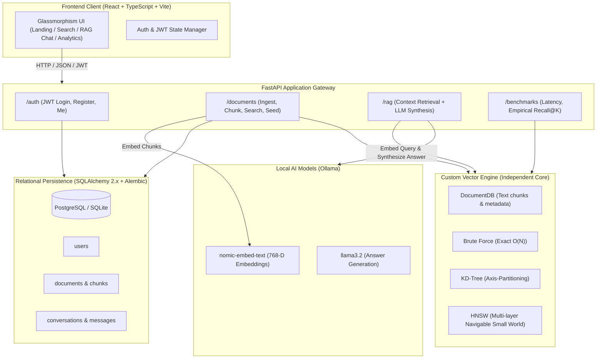

# VectorMind — AI Knowledge & Semantic Search Platform

VectorMind is a high-performance semantic search and Retrieval-Augmented Generation (RAG) platform. Built around a Python vector engine implementing **Brute Force**, **KD-Tree**, and **Hierarchical Navigable Small World (HNSW)** algorithms from scratch, VectorMind provides an end-to-end knowledge architecture with document ingestion (PDF, DOCX, TXT, Markdown), relational persistence with PostgreSQL & SQLite, JWT-authenticated user isolation, empirical benchmarks, and an accessible glassmorphism React dashboard.

---

## Architecture Overview



---

## Features

- **Triple Vector Indexing Engine**: Brute force linear scan, KD-Tree spatial partitioning, and HNSW graph-based approximate nearest neighbor search supporting Euclidean, Cosine, and Manhattan distance metrics.
- **Full RAG Pipeline**: Ingests multi-format documents (PDF, DOCX, TXT, Markdown), performs sliding-window chunking, computes 768-D embeddings using local Ollama (`nomic-embed-text`), retrieves relevant chunks, and synthesizes answers via local LLMs (`llama3.2`).
- **Relational Persistence & Auth**: Built on SQLAlchemy 2.x and Alembic migrations. Includes bcrypt password hashing, JWT bearer token authentication, ownership validation, and user isolation.
- **Empirical Analytics & Benchmarking Dashboard**: Side-by-side performance comparison measuring index build time, median/p95 query latency, throughput, and Information Retrieval metrics (Recall@K, Precision@K, MRR).
- **Glassmorphism & Dark-Professional Interface (v1.1)**: Premium developer workspace with deep blue-black backgrounds (`#071116`), layered charcoal surfaces (`#101d24`), fine cool-gray borders, restrained cyan accents (`#38bdf8`), and zero purple neon or fake decoration.
- **Three-Panel Signature RAG Chat**: Full desktop workspace with left session history rail, central conversation with markdown/code blocks and bottom-pinned composer, and right collapsible sources/evidence panel.
- **Route-Level Code Splitting**: 63% initial bundle optimization with React Suspense and lazy-loaded views.

---

## Technology Stack

- **Backend**: Python 3.11+, FastAPI, Pydantic v2, SQLAlchemy 2.x, Alembic, NumPy, pytest
- **Database**: PostgreSQL (production) or SQLite (local development)
- **Vector Engine**: Custom Python implementation of Brute Force, KD-Tree, and HNSW
- **Embeddings & LLM**: Ollama (`nomic-embed-text` for 768-D embeddings, `llama3.2` for generation)
- **Frontend**: React 18, TypeScript, Vite, React Router 6, Lucide Icons, Recharts, Dark-Professional Vanilla CSS Design System

---

## Prerequisites

1. **Python 3.11+**
2. **Node.js 18+ & npm**
3. **Ollama** running locally with the required models:
   ```bash
   ollama pull nomic-embed-text
   ollama pull llama3.2
   ollama serve
   ```

---

## Getting Started

### 1. Clone the Repository
```bash
git clone https://github.com/Atharv-Dev04/My_Ai.git
cd My_Ai
```

### 2. Configure Environment
Copy the sample environment file:
```bash
cp .env.example .env
```
Default settings connect to local SQLite (`sqlite:///./vectormind.db`) and Ollama on `127.0.0.1:11434`.

### 3. Backend Setup
```bash
cd VectorMind
pip install -e .
alembic upgrade head
python -m uvicorn api.main:app --host 127.0.0.1 --port 8000
```
FastAPI interactive documentation will be available at `http://127.0.0.1:8000/docs`.

### 4. Frontend Setup
In a new terminal:
```bash
cd frontend
npm install
npm run dev
```
Open your browser at `http://localhost:5173`.

---

## API Documentation

| Method | Endpoint | Description |
|---|---|---|
| `GET` | `/status` | System health, Ollama availability, and document count |
| `POST` | `/auth/register` | Register a new user |
| `POST` | `/auth/login` | Authenticate and obtain JWT access token |
| `GET` | `/auth/me` | Fetch authenticated user profile |
| `POST` | `/documents` | Ingest raw text document (chunked & embedded) |
| `POST` | `/documents/upload` | Upload & ingest PDF, DOCX, TXT, or MD files |
| `POST` | `/documents/seed-demo` | Seed 20 canonical demo knowledge items |
| `GET` | `/documents` | List paginated document chunks |
| `DELETE`| `/documents/{id}` | Delete a document chunk |
| `POST` | `/documents/search` | Semantic vector search |
| `POST` | `/rag/ask` | Retrieval-augmented question answering |
| `GET` | `/benchmarks/summary` | Measured benchmarks across search algorithms |
| `POST` | `/benchmarks/evaluate-ir` | Compute Recall@K, Precision@K, and MRR |

---

## Measured Empirical Benchmarks

Benchmarks measured on 12th Gen Intel(R) Core(TM) i5-12500H, Windows 10, Python 3.11.9, NumPy 2.3.5 ($N=1,000$ vectors, 16-D Euclidean, $K=10$):

| Algorithm | Build Time | Median Latency | p95 Latency | Recall@10 |
|---|---|---|---|---|
| **Brute Force** | 0.07 ms | 86.9 μs | 117.2 μs | 1.0000 (Ground Truth) |
| **KD-Tree** | 1.89 ms | 2,911.5 μs | 3,478.5 μs | 1.0000 |
| **HNSW** ($M=16, ef=50$) | 2,014.0 ms | 910.9 μs | 1,220.4 μs | 0.9980 |

*Note: In low dimensions (16-D), Brute Force via vectorized NumPy outperforms index overhead. In high dimensions ($\ge 768$-D embeddings), HNSW logarithmic beam search scales sub-linearly.*

---

## Testing & Quality Assurance

The test suite covers algorithmic parity with original C++ implementations, mathematical properties, edge cases, authentication boundaries, and end-to-end integration:

```bash
# Run backend test suite
pytest VectorMind/tests -v

# Run frontend typecheck and linter
cd frontend
npm run lint
npm run build
```

**Verification Results:**
- **Backend Tests:** 306 passed, 0 failed in 17.65s.
- **Frontend Linter:** 0 errors, 0 warnings across 30 files.
- **Frontend Build:** Clean production bundle with TypeScript checking.

---

## Attribution & License

VectorMind is derived from [Your-OWN-AI](https://github.com/perryvegehan/Your-OWN-AI) by Perry Vegehan, licensed under the MIT License.

### Preserved & Inherited Components
- Core algorithm design concepts (HNSW, KD-Tree, Brute Force search principles)
- Original 20 canonical demo vectors and category structure (16-D)
- Ollama client communication protocol and default hyperparameter selections

### New Contributions
- Complete Python rewrite and optimization of HNSW, KD-Tree, and Brute Force engines with NumPy acceleration
- FastAPI production REST API and Pydantic validation schemas
- Multi-format ingestion pipeline supporting PDF, DOCX, TXT, and Markdown
- SQLAlchemy 2.x relational persistence layer and Alembic database migrations
- JWT bearer authentication, password hashing, and user isolation
- Modern React + TypeScript frontend with accessible glassmorphism design system
- IR evaluation module computing empirical Recall@K, Precision@K, and MRR

This project is licensed under the **MIT License**.
